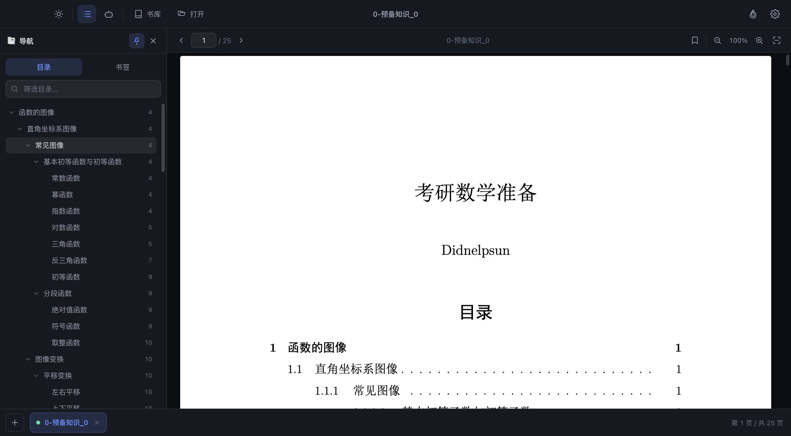

<div align="center">


# MathMaster

**面向数学学习与考研复习的本地 PDF 阅读器（部分内容使用DeepSeek v4 Flash 1017进行辅助构建，核心部分已经经过人工审查）**

目录导航 · 书签续读 · AI 侧栏 · 护眼暖色 · 多标签 · 自定义背景

[](LICENSE)


</div>



MathMaster 是一个使用 **Electron + TypeScript + pdf.js** 构建的桌面 PDF 阅读器，针对数学教材、讲义、考研资料的长时间阅读场景做了优化：左侧目录、自动续读、随时可用的 AI 问答侧栏、护眼暖色、多标签任务栏，以及可自定义的背景。

## ✨ 功能特性

| 功能 | 说明 |
| --- | --- |
| 📑 目录导航 | 解析 PDF 内置大纲，支持层级折叠、关键词筛选、点击跳页；无大纲时自动生成页码网格 |
| 📌 可隐藏 / 可固定侧栏 | 目录侧栏有三种状态：固定占位、悬浮覆盖、隐藏；支持拖拽调整宽度 |
| 🔖 书签与续读 | 自动保存每本 PDF 的最后阅读页码，下次打开自动回到上次位置；支持手动添加 / 删除书签 |
| 🤖 AI 侧栏 | 内嵌 DeepSeek / ChatGPT，可自定义任意聊天网址；同样可隐藏、固定、调宽，支持刷新和在浏览器打开 |
| 🌗 主题切换 | 左上角按钮一键切换深色 / 浅色主题，设置持久化 |
| 🕯️ 护眼暖色 | 一键为 PDF 区域叠加暖色滤镜，强度可调，降低夜间阅读的蓝光刺激 |
| 🗂️ 多标签任务栏 | 底部任务栏展示所有打开的 PDF，点击切换、支持关闭标签，标签颜色按文件夹区分 |
| 🎨 自定义背景 | 可设置背景颜色、背景图片、图片透明度、界面不透明度与背景模糊 |
| 💾 记忆状态 | 标签页、当前文档、阅读进度、书签、主题和背景全部本地保存，重启后恢复 |
| 🪟 虚拟化渲染 | 只渲染当前可见页，支持缩放、适应宽度，流畅浏览大型 PDF |

### 快捷键

| 操作 | macOS | Windows / Linux |
| --- | --- | --- |
| 打开 PDF | `⌘ O` | `Ctrl O` |
| 切换目录侧栏 | `⌘ B` | `Ctrl B` |
| 切换 AI 侧栏 | `⌘ J` | `Ctrl J` |
| 打开设置 | `⌘ ,` | `Ctrl ,` |
| 关闭当前标签 | `⌘ W` | `Ctrl W` |
| 放大 / 缩小 | `+` / `-` | `+` / `-` |
| 适应宽度 | `0` | `0` |

## 🧱 技术栈

- **Electron 45** —— 跨平台桌面外壳，使用自定义 `app://` 协议加载前端资源
- **TypeScript 5** —— 主进程、预加载脚本与渲染进程全部类型化
- **pdf.js (pdfjs-dist)** —— PDF 解析、目录提取、Canvas 分页渲染
- **esbuild** —— 快速打包主进程、预加载脚本、渲染进程与 pdf.js Worker
- **electron-builder** —— 生成 `.app` / DMG / ZIP / NSIS / AppImage 等安装包

## 🚀 快速开始

环境要求：**Node.js ≥ 20**（开发时使用 Node 25 + npm 11 验证）。

```bash
git clone <your-repo-url>
cd MathMaster

npm install
npm start        # 构建并启动
```

其他命令：

```bash
npm run dev        # 监听源码变更，自动重新构建并重启
npm run build      # 仅构建到 dist/
npm run typecheck  # TypeScript 类型检查
```

首次启动会自动扫描项目目录下的 PDF 并打开第一本。你也可以：

- 点击顶部 **打开** 或书库弹窗底部的 **打开本地 PDF…** 选择任意 PDF；
- 把 PDF 放到项目根目录的任意子文件夹，启动时自动收录；
- 通过环境变量指定书库根目录：`MATHMASTER_LIBRARY=/path/to/pdfs npm start`。

## 📦 打包成独立 App

项目已经配置好 [electron-builder](https://www.electron.build/)，配置文件为 [`electron-builder.config.cjs`](electron-builder.config.cjs)。

### 1. 生成可双击运行的 App（推荐先试这个）

```bash
npm run pack
```

产物（取决于当前平台）：

| 平台 | 产物路径 |
| --- | --- |
| macOS | `release/mac-arm64/MathMaster.app`（Intel 为 `release/mac/`） |
| Windows | `release/win-unpacked/MathMaster.exe` |
| Linux | `release/linux-unpacked/MathMaster` |

### 2. 生成安装包

```bash
npm run dist:mac     # macOS：DMG + ZIP
npm run dist:win     # Windows：NSIS 安装器 + 便携版
npm run dist:linux   # Linux：AppImage + deb
npm run dist         # 当前平台的默认目标
```

macOS 实测产物：

```text
release/MathMaster-1.0.0-arm64.dmg        # 可直接拖入「应用程序」
release/MathMaster-1.0.0-arm64-mac.zip
```

> `pack` 生成的 `.app` 本身已经是独立应用，可以复制到 `/Applications` 或分发给他人；`dmg/zip` 只是更方便分发。

### 3. 关于代码签名与公证（macOS）

本地自用可以直接构建，但未签名的应用首次打开会被 Gatekeeper 拦截。任选其一：

```bash
# 方式一：右键 App → 打开
# 方式二：移除隔离属性
xattr -cr /Applications/MathMaster.app
```

如需公开分发，建议配置 Apple Developer ID 进行签名与公证（在 CI 中设置 `CSC_LINK`、`CSC_KEY_PASSWORD`，或使用 `@electron/notarize`）。本地无证书构建时可关闭签名探测：

```bash
CSC_IDENTITY_AUTO_DISCOVERY=false npm run dist:mac
```

### 4. 关于跨平台构建

在 macOS 上交叉构建 Windows 安装包通常需要安装 `wine`，Linux 目标也可能需要 Docker 或额外依赖。**最稳妥的做法是使用 GitHub Actions 在对应系统上分别构建**（`macos-latest` / `windows-latest` / `ubuntu-latest`）。

仓库已附带 [`.github/workflows/build.yml`](.github/workflows/build.yml)：PR 会自动执行类型检查与构建；推送到 `main` / 手动触发时会在三大平台打包，并把安装包发布到名为 **Latest build** 的预发布 Release；推送 `v*` 标签时会创建正式 Release 并附带全部安装包。

### 5. 关于电子版教材与自定义图标

- 本仓库**不提交任何 PDF / 教材资料**。如果本地存在 `library/`，或存在 `同济-上册/`、`同济-下册内容/` 这类私有资料目录，打包时会自动复制到应用的 `Resources/library/`（这些目录已被 `.gitignore` 忽略）；打包后的 App 启动时会从 `process.resourcesPath/library` 扫描 PDF，因此可以离线自带书库。
  如果不希望随包分发资料，删除 `electron-builder.config.cjs` 中对应的 `extraResources` 目录即可，用户仍可通过「打开本地 PDF」使用。
- 应用图标位于 `build/icon.svg`（源文件）以及 `build/icon.png` / `icon.icns` / `icon.ico`（打包用）。替换图标后重新执行打包命令即可。
- 如果本地存在 `node_modules/electron/dist`，打包时会直接复用已安装的 Electron，避免重复下载；在 CI 或未安装本地 Electron 的环境中会自动回退为 electron-builder 下载。若需交叉编译到其他平台，可删除本地 Electron 目录或设置 `ELECTRON_MIRROR` 使用镜像。

## 🗂️ 项目结构

```text
MathMaster/
├── src/
│   ├── main.ts                 # 主进程：窗口、app:// 协议、IPC、书库扫描
│   ├── preload.ts              # 预加载：通过 contextBridge 暴露安全 API
│   ├── shared/api.ts           # 主进程与渲染进程共享的类型
│   └── renderer/
│       ├── renderer.ts         # 渲染进程入口
│       ├── app.ts              # 标签、面板、书签、设置、AI 侧栏逻辑
│       ├── pdf.ts              # pdf.js 封装：目录解析 + 虚拟化分页渲染
│       ├── state.ts            # 设置 / 书签 / 标签页的持久化
│       ├── icons.ts            # 内置 SVG 图标
│       ├── index.html          # 页面结构
│       └── styles.css          # 主题、布局与动效
├── scripts/
│   ├── build.mjs               # esbuild 构建脚本
│   └── dev.mjs                 # 开发监听脚本
├── build/                      # 应用图标（png / icns / ico / svg）
├── docs/screenshot.png         # README 截图
├── electron-builder.config.cjs # 打包配置
├── tsconfig.json
└── package.json
```

## 💾 数据存储与重置

设置、标签页、阅读进度和书签保存在 Electron 的 `localStorage`（归属于 `app://app` 源），随用户数据目录一起持久化：

| 平台 | 用户数据目录 |
| --- | --- |
| macOS | `~/Library/Application Support/MathMaster` |
| Windows | `%APPDATA%\MathMaster` |
| Linux | `~/.config/MathMaster` |

删除该目录即可恢复出厂状态。AI 网站的登录状态保存在独立的 `persist:chat` 会话分区中，同样位于上述目录。

## 🔐 安全说明

- 渲染进程开启 `contextIsolation`、关闭 `nodeIntegration`；主进程能力仅通过 preload 暴露的少量 IPC 接口提供。
- 页面资源通过自定义 `app://` 协议加载，并做路径穿越校验；只允许打开 `http(s)` 外部链接。
- 设置了 CSP，限制脚本、样式、图片与 Worker 的来源。
- AI 侧栏使用 Electron `<webview>` 加载第三方网站，登录凭据由对应网站自身管理，应用不会读取或上传聊天内容。

## ⚠️ 已知限制

- 当前未实现 PDF **文字选择 / 复制 / 批注**（未添加 pdf.js text layer）。
- 加密或需要密码的 PDF 暂不支持，会提示加载失败。
- 部分网站可能限制被内嵌，此时可点击 AI 侧栏右上角的「在浏览器打开」。
- 本仓库不包含任何教材 / 讲义 PDF。由于版权与隐私原因，PDF 不会提交到仓库；请将你自己的资料放在本地子文件夹中使用，并避免将私密或受版权保护的文件推送到公开仓库。

## 🤝 贡献

欢迎提交 Issue 和 Pull Request。提交前请确保：

```bash
npm run typecheck
npm run build
```

## 📄 License

[MIT](LICENSE) © 2026 MathMaster contributors

> 本项目代码以 MIT 协议开源。仓库不包含教材 PDF 等第三方内容；用户自行导入的文档版权归其各自作者所有。
